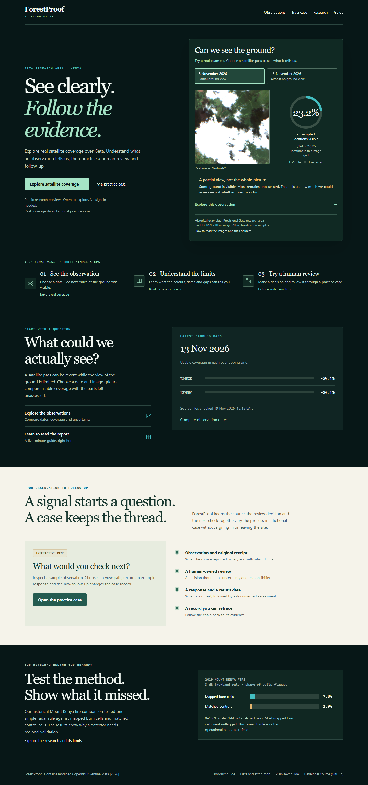
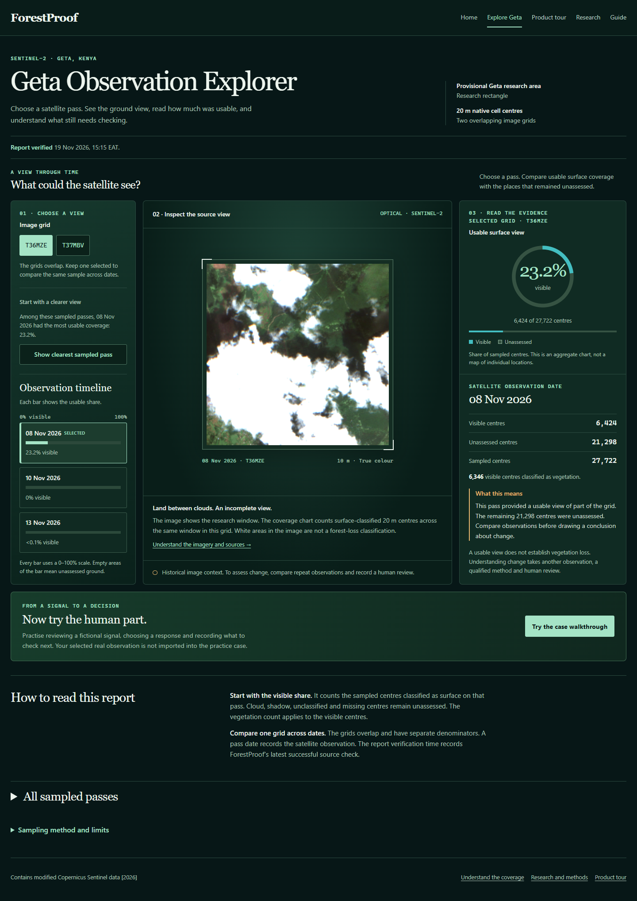
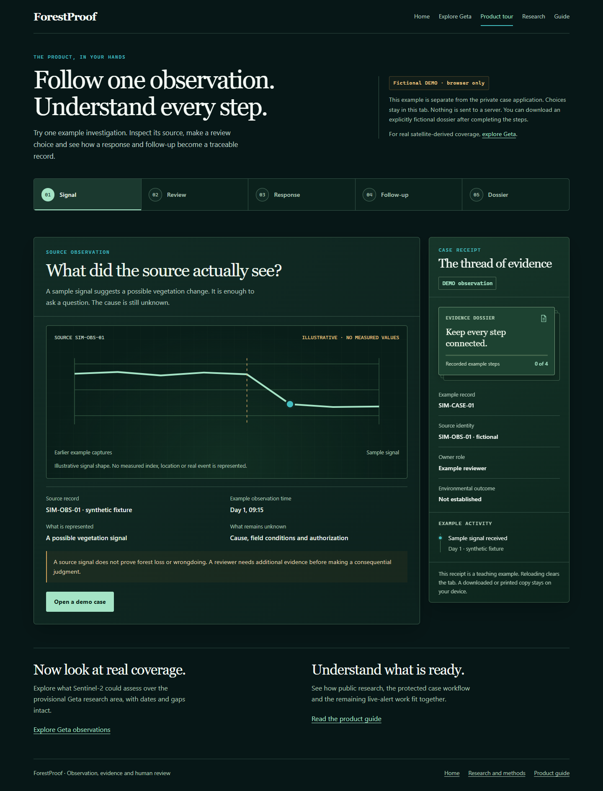
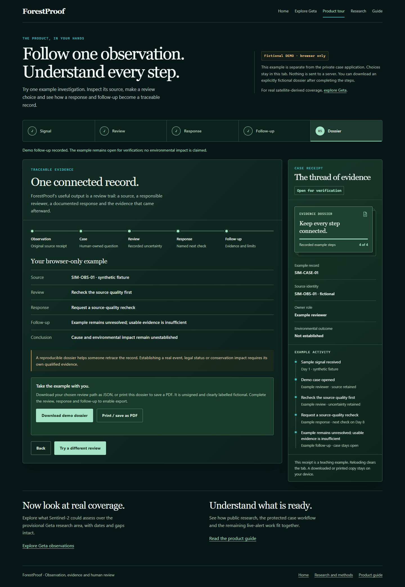
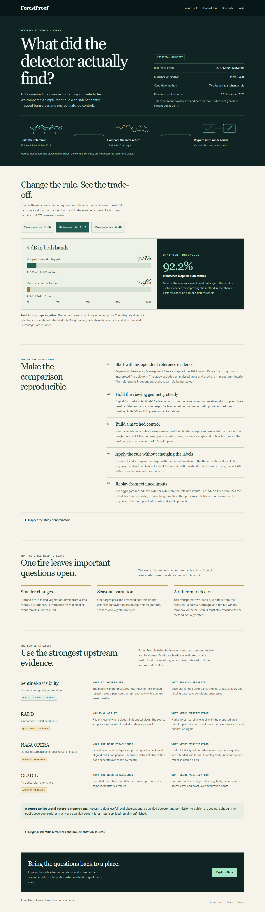
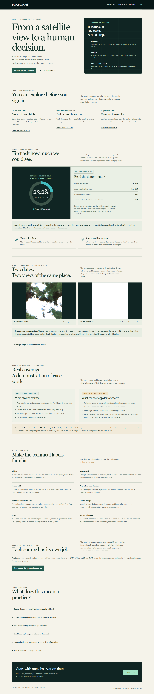

# ForestProof independent product review

Prepared 20 November 2026, Africa/Nairobi. This packet connects the deployed public product, captured desktop/mobile views, original goals and implementation. Use it to assess what ForestProof delivers today and what remains before an operational alert launch.

The public experience runs on Contabo. The captured public source is **`5dc1817503de3eb000e7a4c28f1dbd4e057b4a54`**. The corresponding reviewed repository snapshot, including the release record, is **`7230414e123b8847d5a4f69aa96dc5da0381df27`**. Code and research documentation can be inspected publicly. Protected case records and private evidence require separate access.

## The intended product

ForestProof connects **environmental observation → original source and provenance → human-owned review → recorded response → dated follow-up → a reproducible case dossier**. A visitor should understand what was observed, what remains uncertain, who is responsible for a review and what should happen next.

The owner wants an understandable public product useful to enthusiasts, tinkerers and conservation practitioners, with credible implementation and research evidence for grant applications. The strategic goal is to use lawful upstream scientific data economically and build differentiation through evidence quality, coordinated review and follow-up. Rebuilding a provider capability should have a demonstrated benefit. Grant funding, paying users, verified ecological impact and a defensible moat are goals or hypotheses, not established achievements.

## Open the public product

1. [Homepage](https://vmi3711898.contaboserver.net/welcome): the product introduction, two dated source images, coverage explanations and a three-step first-visit path.
2. [Geta Observation Explorer](https://vmi3711898.contaboserver.net/visibility): selected date/grid, matching historical image when available, aggregate counts and their meaning. Without a date link it starts with the clearest sampled pass.
3. [Interactive Case Walkthrough](https://vmi3711898.contaboserver.net/tour): a fictional signal, review choice, response, follow-up and dossier. Completion enables an unsigned fictional JSON download and browser print/save-PDF presentation.
4. [Research](https://vmi3711898.contaboserver.net/research): historical radar-method results, selectable thresholds, measured limitations and source-qualification status.
5. [Product Guide](https://vmi3711898.contaboserver.net/guide): reading examples, glossary, workflow, sources and current capabilities.
6. [Plain-text project guide](https://vmi3711898.contaboserver.net/project.txt): an accessible overview of implementation, research and hosting.

The temporary hostname may be inaccessible to some AI retrieval tools even when an ordinary browser can load it. If it fails, use the captured views and exact-version source links below. State the access failure. Reading HTML or screenshots does not establish that an interaction was executed.

## Actual public screenshots

These are captures of the deployed pages, not concept images or protected application screens. The desktop viewport is 1440 × 1000 and the phone viewport is 390 × 844. [Capture metadata](review/capture.json) records the UTC capture timestamp, exact URL, viewport, selected state, deployed source and SHA-256 of each file. Screenshots show a point in time; source-check timestamps and future deployments can change.

### Homepage

[Open the phone homepage capture](https://raw.githubusercontent.com/thegodmustwin/forestproof/main/docs/review/mobile-home.png).

### Observation explorer

[Open the phone explorer capture](https://raw.githubusercontent.com/thegodmustwin/forestproof/main/docs/review/mobile-explorer.png).

### Walkthrough before review

[Open the phone signal-stage capture](https://raw.githubusercontent.com/thegodmustwin/forestproof/main/docs/review/mobile-tour-signal.png).

### Walkthrough after completion

[Open the phone completed-dossier capture](https://raw.githubusercontent.com/thegodmustwin/forestproof/main/docs/review/mobile-tour-dossier.png).

The captured practice path chooses a source-quality review and an unresolved follow-up. The record is explicitly fictional and unsigned. It contains no real reviewer identity or private case notes.

### Research

[Open the phone research capture](https://raw.githubusercontent.com/thegodmustwin/forestproof/main/docs/review/mobile-research.png).

### Product guide

[Open the phone guide capture](https://raw.githubusercontent.com/thegodmustwin/forestproof/main/docs/review/mobile-guide.png).

## Read the context and implementation

These exact-version links avoid accidentally reviewing cached earlier documentation. Read newer dated status entries before older historical records.

- [Public product guide](https://raw.githubusercontent.com/thegodmustwin/forestproof/7230414e123b8847d5a4f69aa96dc5da0381df27/docs/PUBLIC_GUIDE.md): what exists, how it works and its limits.
- [Project context](https://raw.githubusercontent.com/thegodmustwin/forestproof/7230414e123b8847d5a4f69aa96dc5da0381df27/docs/PROJECT_CONTEXT.md): origin, intended users and strategic thesis.
- [Project map](https://raw.githubusercontent.com/thegodmustwin/forestproof/7230414e123b8847d5a4f69aa96dc5da0381df27/docs/PROJECT_MAP.md): implementation, research and domain-document map.
- [Current status](https://raw.githubusercontent.com/thegodmustwin/forestproof/7230414e123b8847d5a4f69aa96dc5da0381df27/execution/CURRENT_STATUS.md): dated deployment pins and recorded test evidence.
- [Next actions](https://raw.githubusercontent.com/thegodmustwin/forestproof/7230414e123b8847d5a4f69aa96dc5da0381df27/execution/NEXT_ACTIONS.md) and [launch strategy](https://raw.githubusercontent.com/thegodmustwin/forestproof/7230414e123b8847d5a4f69aa96dc5da0381df27/docs/LAUNCH_STRATEGY.md).
- [Project decisions](https://raw.githubusercontent.com/thegodmustwin/forestproof/7230414e123b8847d5a4f69aa96dc5da0381df27/docs/PROJECT_DECISIONS.md), [project brain](https://raw.githubusercontent.com/thegodmustwin/forestproof/7230414e123b8847d5a4f69aa96dc5da0381df27/PROJECT_BRAIN.md) and [design direction](https://raw.githubusercontent.com/thegodmustwin/forestproof/7230414e123b8847d5a4f69aa96dc5da0381df27/DESIGN.md).
- [Original concept brief](https://raw.githubusercontent.com/thegodmustwin/forestproof/7230414e123b8847d5a4f69aa96dc5da0381df27/docs/origin/FORESTPROOF_ORIGIN_BRIEF.txt) and [master build directive](https://raw.githubusercontent.com/thegodmustwin/forestproof/7230414e123b8847d5a4f69aa96dc5da0381df27/docs/origin/MASTER_BUILD_DIRECTIVE.txt): historical intentions; aspirational claims require independent evidence.
- [Provider-independence research](https://raw.githubusercontent.com/thegodmustwin/forestproof/7230414e123b8847d5a4f69aa96dc5da0381df27/docs/GNW_INDEPENDENCE_RESEARCH.md), [direct-source evaluation](https://raw.githubusercontent.com/thegodmustwin/forestproof/7230414e123b8847d5a4f69aa96dc5da0381df27/docs/DIRECT_SOURCE_EVALUATION.md) and [commercial strategy](https://raw.githubusercontent.com/thegodmustwin/forestproof/7230414e123b8847d5a4f69aa96dc5da0381df27/docs/COMMERCIAL_STRATEGY.md): source access, coverage, costs, method validation and differentiation hypotheses.

The [public repository](https://github.com/thegodmustwin/forestproof) exposes tracked code and documentation. In the reviewed snapshot, use [the public product implementation](https://github.com/thegodmustwin/forestproof/tree/7230414e123b8847d5a4f69aa96dc5da0381df27/tools/sentinel_visibility), [web application](https://github.com/thegodmustwin/forestproof/tree/7230414e123b8847d5a4f69aa96dc5da0381df27/apps/web), [API service](https://github.com/thegodmustwin/forestproof/tree/7230414e123b8847d5a4f69aa96dc5da0381df27/services/api) and the project map to inspect specific claims. A source-code review of the protected application is different from using its deployed interface.

## Facts that must stay accurate

- **Geta is in Kenya.** The public visibility report uses Sentinel-2 optical scene classifications. Radar experiments are research, with separate methods and limits.
- The real public counts measure usable optical coverage. They do not establish forest loss, its cause, legality or ecological impact. A source-check timestamp records verification; an observation date records the satellite acquisition.
- Published image crops cover only T36MZE on 8 and 13 November 2026. Other grid/date selections explicitly lack matching image context. The provisional research rectangle is not an official forest boundary.
- The 87.2% coverage, −3.4 dB threshold, preserved-canopy patches and disturbance polygons in the owner's earlier visual reference were illustrative. They are not measured ForestProof results.
- The anonymous `/tour` is fictional and browser-only. Its downloadable JSON and printable dossier are unsigned fictional practice outputs. No live source record is imported by opening the tour.
- The protected saved-case app uses synthetic DEMO records and shared tester access. Tester credentials do not unlock a qualified live-alert feed.
- Genuine historical research evidence, owner-review notes, original evidence archives, provider keys and passwords remain private. This packet does not grant access to them. Their repository descriptions are not independent verification of the private files.
- Current record-level feed qualification, production person-level owner identity and independent recovery of the genuine signed-in case remain launch work. Public exploration, an operational real-data pilot and a grant application require separate readiness judgments.

## Requested independent assessment

Evaluate the actual product against the intended evidence-and-response loop. Cite the pages, captured states and source files supporting each conclusion.

1. Explain what a user can accomplish today. Can a first-time visitor understand the product and choose a useful next action?
2. Do the imagery, dates, coverage, uncertainty and unavailable states communicate meaningful evidence? Does the visual identity make the task clearer?
3. Where your tools allow it, complete the fictional review and obtain its dossier. Identify comprehension or interaction failures. If you cannot execute it, label the finding as source or screenshot inspection.
4. What practical value exists for enthusiasts, tinkerers and conservation practitioners? Which users currently have an incomplete journey?
5. Compare the original goals with implemented capabilities: achieved, partial or missing. Assess the value of upstream independence and proposed differentiation against actual operating cost and user benefit.
6. Assess readiness separately for public exploration, an operational live-data pilot and a grant application. Identify which claims can be made credibly today and what evidence is missing.
7. Rank five next improvements by user value and launch relevance. Identify concrete actions and acceptance criteria rather than suggesting visual polish alone.

Finish with an access log: which public URLs, source files, images and interactions you directly inspected, which you could not access, and what you inferred. Do not claim exhaustive repository inspection, live interaction testing, provider access or private-record verification unless you actually performed it.
